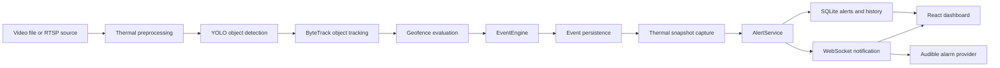

# Development of a Video Surveillance System for Object Detection and Intrusion Monitoring

**Application:** Thermal Perimeter Surveillance
**Release:** v1.0
**Development branch:** `feature/runtime-core`
**Repository:** [SamagataSarkar/Thermal-Perimeter-Surveillance](https://github.com/SamagataSarkar/Thermal-Perimeter-Surveillance)

Thermal Perimeter Surveillance is a video surveillance system for perimeter and
restricted-area monitoring. It combines YOLO-based thermal object detection,
ByteTrack tracking, geofence evaluation, persisted intrusion alerts, thermal
evidence snapshots, audible warnings, and a real-time React dashboard.

The Version 1 application supports person and vehicle intrusion monitoring,
configurable dwell-time alerts, recorded video files, and RTSP sources. Model
predictions are not conclusive identification; operators must verify alerts and
evidence.

## Table of contents

- [Technology stack](#technology-stack)
- [Architecture](#architecture)
- [Detection model](#detection-model)
- [Repository structure](#repository-structure)
- [Prerequisites](#prerequisites)
- [Windows setup](#windows-setup)
- [Running the application](#running-the-application)
- [First-time operator workflow](#first-time-operator-workflow)
- [Alert logic](#alert-logic)
- [Database and configuration](#database-and-configuration)
- [Dataset documentation](#dataset-documentation)
- [Troubleshooting](#troubleshooting)
- [Version information and limitations](#version-information-and-limitations)

## Technology stack

| Area | Technology used |
| --- | --- |
| Backend | Python, FastAPI, Uvicorn |
| Inference | Ultralytics YOLO, ByteTrack, OpenCV, NumPy |
| Persistence | SQLAlchemy, SQLite, Alembic |
| Frontend | React 18, Vite, TypeScript |
| Browser communication | WebSockets, MJPEG stream |
| Frontend UI | React Router, Recharts, Lucide React |
| Testing | pytest/unittest-compatible Python tests, Vitest, Testing Library |

Python dependencies are listed in [`requirements.txt`](requirements.txt).
Frontend dependencies and scripts are listed in
[`frontend/package.json`](frontend/package.json). PyTorch is intentionally not
listed as a generic requirement: install the CPU or CUDA build appropriate for
the target machine using the official PyTorch installation instructions.
Ultralytics declares PyTorch as a dependency.

## Architecture

The existing Phase 1 inference modules remain the reusable detection and
tracking layer. The backend `RuntimeManager` owns monitoring workers and does
not make inference dependent on a mounted browser page.



Primary data flow:

```text
Video source
  -> object detection
  -> object tracking
  -> geofence evaluation
  -> event generation
  -> snapshot capture
  -> alert generation
  -> WebSocket notification
  -> dashboard and audible alarm
```

Component responsibilities:

- **Detection and tracking engine:** `scripts/inference/` preprocesses frames,
  runs the configured YOLO checkpoint, and obtains ByteTrack IDs and class
  metadata.
- **EventEngine:** evaluates track observations against geofences and emits
  `ENTRY`, `EXIT`, `DWELL`, and `FIRST_OBSERVED_INSIDE` event transitions.
- **Geofence management:** stores normalized polygons per video source and
  applies the configured debounce, hysteresis, observation, and tracking-loss
  behavior.
- **RuntimeManager:** starts and stops backend-owned inference workers,
  persists events and snapshots, publishes metrics, and exposes the current
  annotated frame.
- **AlertService:** creates one persisted actionable alert per supported event,
  associates evidence snapshots, and publishes alert notifications.
- **Database and snapshots:** SQLite stores sources, zones, sessions, events,
  snapshots, alerts, and application settings. Managed snapshot JPEGs are
  written below `backend-data/snapshots/`.
- **WebSockets and MJPEG:** `/ws/monitor/{session_id}` carries session,
  detection, event, metric, and alert messages. `/api/stream/{session_id}`
  serves the annotated MJPEG feed.
- **React application:** shared `AlarmProvider` and `MonitoringProvider`
  preserve alarm and monitoring state while routes change. The dashboard
  consumes the backend as its source of truth.

## Detection model

The backend uses the included custom checkpoint:

```text
runs/detect/models/thermal_perimeter_yolo11n-2/weights/best.pt
```

The unified class mapping in [`datasets/unified/data.yaml`](datasets/unified/data.yaml)
is:

| Class ID | Class |
| ---: | --- |
| 0 | person |
| 1 | vehicle |
| 2 | animal |
| 3 | drone |

The configured monitoring inference values are:

| Setting | Default |
| --- | ---: |
| Inference image size | `960` |
| Detection confidence | `0.30` |
| IoU/NMS threshold | `0.50` |

`THERMAL_INFERENCE_SIZE` can override the positive inference image size.
`THERMAL_MODEL_PATH` can select another checkpoint. The default backend model
path is resolved from the project root, so a session fails clearly if the
configured weight file is missing.

The included custom checkpoint is used for Version 1 inference. The generic
`yolo11n.pt` file is the base model referenced by the training script and is
not required by the backend when `best.pt` is available. Training images and
labels are not fully included in the GitHub repository; see
[`datasets/README.md`](datasets/README.md). No accuracy or benchmark figures
are claimed here.

## Repository structure

```text
Thermal-Perimeter-Surveillance/
├── backend/
│   ├── alembic/
│   │   └── versions/             # Sequential database migrations
│   └── app/                      # FastAPI app, models, schemas, services
├── frontend/                     # React/Vite/TypeScript dashboard
├── scripts/
│   └── inference/                # Detector, tracker, geofence, events, metrics
├── runs/detect/models/            # Included trained inference checkpoint
├── datasets/                     # Dataset metadata and local dataset workspace
├── tests/                        # Backend, inference, and frontend-related tests
├── custom_tracker.yaml           # ByteTrack configuration
├── alembic.ini                   # Alembic location and SQLite URL
├── requirements.txt              # Direct Python dependencies
└── README.md
```

`backend-data/` and `snapshots/` are local runtime data locations and are
ignored by Git. `demo_thermal*.mp4` files are local demonstration inputs when
available.

## Prerequisites

Install the following before setup:

- Git.
- A supported Python installation capable of installing the versions in
  [`requirements.txt`](requirements.txt). The repository does not declare a
  Python `requires-python` minimum.
- Node.js and npm compatible with the versions in
  [`frontend/package.json`](frontend/package.json). The frontend does not
  declare an `engines` minimum.
- An optional NVIDIA GPU with a compatible CUDA/PyTorch installation. CPU
  inference is supported by the application, but performance depends on the
  host.

PyTorch must be installed separately from the official CPU/CUDA selector. Do
not force a CUDA-specific wheel through `requirements.txt`.

## Windows setup

Open PowerShell and run:

```powershell
git clone -b feature/runtime-core https://github.com/SamagataSarkar/Thermal-Perimeter-Surveillance.git
cd Thermal-Perimeter-Surveillance

python -m venv thermal_env
.\thermal_env\Scripts\Activate.ps1

python -m pip install --upgrade pip
python -m pip install -r requirements.txt
```

Install the PyTorch build selected for the machine from the official PyTorch
instructions, then install the frontend packages:

```powershell
cd frontend
npm install
cd ..
```

Initialize a new SQLite database from the repository root:

```powershell
New-Item -ItemType Directory -Force backend-data | Out-Null
python -m alembic -c alembic.ini upgrade head
```

The application also creates the SQLite parent directory and managed snapshot
directory when it starts. The explicit `New-Item` command makes the fresh
database location visible and safe for the first migration. Do not use
`stamp head` for a fresh database: `upgrade head` creates the original schema,
alerts table, and application settings table through the sequential migrations.

## Running the application

Use two PowerShell terminals from the repository root.

### Backend

```powershell
.\thermal_env\Scripts\Activate.ps1
python -m uvicorn backend.app.main:app --host 127.0.0.1 --port 8000
```

The backend API is available at `http://127.0.0.1:8000`. FastAPI's interactive
documentation is available at `http://127.0.0.1:8000/docs`; the OpenAPI JSON
is at `http://127.0.0.1:8000/openapi.json`.

### Frontend

```powershell
cd frontend
npm run dev
```

Open the Vite URL shown in the terminal, normally `http://localhost:5173/`.
The Vite development server proxies `/api` and `/ws` to
`http://127.0.0.1:8000`. Set `VITE_API_BASE_URL` when the backend is hosted at
another origin.

Useful checks from `frontend/`:

```powershell
npm test -- --run
npm run typecheck
npm run build
```

## First-time operator workflow

1. Open **Configuration** and register a recorded thermal video file or RTSP
   source.
2. Create and save normalized geofence polygons for that source.
3. In **Live Monitoring**, select the geofences for the next session.
4. Start monitoring.
5. Observe the annotated video, detection boxes, track IDs, FPS, and latency.
6. Configure the restricted-zone dwell threshold in **Configuration**.
7. Select **Enable audible alarm**. Browser policy requires this explicit user
   interaction before playback can be active.
8. Review person and vehicle alerts in **Alerts & Events**.
9. Use **View Evidence** when a thermal snapshot is available.
10. Acknowledge, resolve, or dismiss alerts as appropriate.
11. Stop monitoring explicitly with **Stop Monitoring**.

Monitoring continues when navigating between dashboard pages. A changed dwell
threshold is persisted and applies to newly created monitoring sessions; an
already-running session keeps its captured configuration.

## Alert logic

The current Version 1 actionable rules are:

- Person `ENTRY` -> `WARNING`.
- Vehicle `ENTRY` -> `WARNING`.
- Person `DWELL` -> `HIGH`.
- Vehicle `DWELL` -> `HIGH`.
- Animal detections do not generate these intrusion alerts.
- `FIRST_OBSERVED_INSIDE` retains operator-review semantics and is not treated
  as confirmed intrusion.
- `EXIT` remains in event history.

Alert lifecycle states are `NEW`, `ACKNOWLEDGED`, `RESOLVED`, and `DISMISSED`.
New high-priority dwell alerts activate the shared alarm provider. The provider
deduplicates alert IDs, repeats the warning at a controlled interval, and
stops when no eligible `NEW` high-priority alerts remain.

Modern browsers may block autoplay. The dashboard reports when playback is
blocked and provides an explicit enable/reactivate control. A saved preference
does not bypass browser policy, and the UI must not claim audio is active while
the browser has blocked playback.

Thermal detections are model predictions. Vegetation, stationary structures,
and other heat sources can produce false positives. Operators must verify the
alert, source, track, geofence, dwell duration, and available evidence.

## Database and configuration

The default database is:

```text
backend-data/thermal.db
```

The path is configured in [`alembic.ini`](alembic.ini) and can be overridden
for the application with `THERMAL_DATABASE_URL`. Runtime snapshots default to
`backend-data/snapshots/` and can be moved with
`THERMAL_SNAPSHOT_DIRECTORY`.

Migration history:

| Revision | Purpose |
| --- | --- |
| `0001_initial_schema` | Sources, sessions, geofences, events, snapshots, and metrics |
| `0002_alerts` | Persisted alerts and alert indexes |
| `0003_application_settings` | Persisted application settings, including dwell threshold |

After pulling a future migration, apply it from the repository root:

```powershell
.\thermal_env\Scripts\Activate.ps1
python -m alembic -c alembic.ini upgrade head
```

The database stores source definitions, geofences, monitoring sessions, event
history, alert state, metrics, and settings. Snapshot image files and local
database files should remain local and should not be committed. RTSP
credentials are currently stored by the backend as supplied and are not
encrypted at rest; protect local database files accordingly.

## Dataset documentation

Dataset metadata, class mapping, provider references, and retraining notes are
in [`datasets/README.md`](datasets/README.md). The current tracked GitHub
dataset content is metadata/configuration; the complete training image and
label collections must be obtained and prepared separately before retraining.

## Troubleshooting

### Python or virtual-environment errors

Confirm that the environment is active and use its interpreter explicitly:

```powershell
.\thermal_env\Scripts\Activate.ps1
python -m pip install -r requirements.txt
python -c "import fastapi, sqlalchemy, ultralytics; print('Python dependencies available')"
```

If PowerShell blocks activation, use the machine's approved execution-policy
procedure or invoke `.\thermal_env\Scripts\python.exe` directly.

### Node or npm errors

Run npm commands from `frontend/`, not the repository root:

```powershell
cd frontend
npm install
npm run typecheck
```

### Missing model checkpoint

Verify that
`runs/detect/models/thermal_perimeter_yolo11n-2/weights/best.pt` exists.
Alternatively set an absolute path before starting the backend:

```powershell
$env:THERMAL_MODEL_PATH = 'C:\path\to\best.pt'
python -m uvicorn backend.app.main:app --host 127.0.0.1 --port 8000
```

### SQLite migration errors

Ensure `backend-data/` exists and run migrations from the repository root:

```powershell
New-Item -ItemType Directory -Force backend-data | Out-Null
python -m alembic -c alembic.ini upgrade head
```

Do not stamp a new empty database at `head`.

### RTSP connection problems

Confirm that the RTSP URL is reachable by the host and that the source
credentials are correct. RTSP hardware and network conditions are not tested
by this repository. Try a recorded file first to separate source connectivity
from inference configuration.

### Browser audio autoplay restrictions

Open the dashboard and click **Enable audible alarm** or **Reactivate audible
alarm**. A persisted preference cannot override a browser gesture requirement.
Use **Test alarm** after enabling audio.

### Port conflicts

Change the backend `--port` and configure the frontend API base URL or Vite
proxy for the new backend origin. The documented defaults are backend port
`8000` and Vite port `5173`.

### GPU unavailable or CUDA incompatibility

Install a PyTorch build matching the host's CPU or CUDA environment using the
official PyTorch instructions. The generic requirements deliberately do not
select a CUDA-specific build. CPU inference remains available, with
host-dependent performance.

## Version information and limitations

- **Current release:** v1.0.
- **Current development branch:** `feature/runtime-core`.
- **Repository:** [https://github.com/SamagataSarkar/Thermal-Perimeter-Surveillance](https://github.com/SamagataSarkar/Thermal-Perimeter-Surveillance).
- Version 2 model improvements and retraining are outside Version 1.
- Thermal false positives, including vegetation and stationary structures, are
  possible.
- The system does not provide guaranteed intrusion identification, production
  certification, physical actuators, or automatic locks.
- RTSP operation depends on the source and network environment.
- CPU/GPU inference performance depends on the machine and installed
  PyTorch/CUDA configuration.
